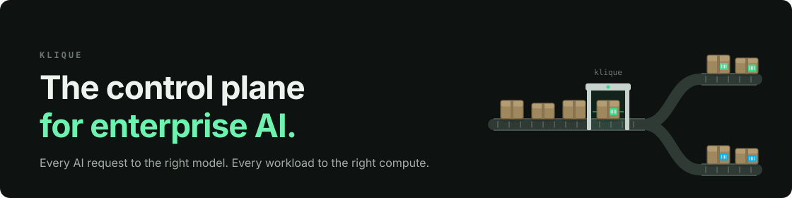
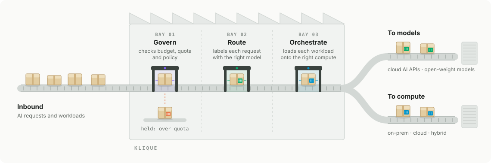

<p align="center">
  <picture>
    <source media="(prefers-color-scheme: dark)" srcset="https://klique.ai/assets/images/klique-logo-white.svg">
    
  </picture>
</p>

<p align="center"></p>

# KliqueNotebooks

A hands-on guide to model endpoints and developer sessions on [Klique](https://klique.ai/docs/latest/). Deploy a model with [vLLM](https://docs.vllm.ai/), call it through the AI Application Gateway, govern its usage and cost through the LLM Gateway, and run a tool-using agent. Or start with managed JupyterLab, SSH, VS Code, Claude Code, and Claude Desktop sessions, then choose projects such as a governed playground, repository RAG, agent debugging, model evaluation, resumable training, or ComfyUI.

This is not a vLLM tutorial. Klique runs vLLM for you; Sections 01–04 turn a model name into a governed endpoint, and Sections 05–09 cover developer sessions on managed compute.

<p align="center">
  <picture>
    <source media="(prefers-color-scheme: dark)" srcset="images/platform-dark.svg">
    
  </picture>
</p>

## Structure

| Section | Directory | Topic |
|---------|-----------|-------|
| 00 | [Orientation](00_Orientation/00_Orientation.ipynb) | Two learning paths, scope, mental model, prerequisites, and setup. Read this first. |
| 01 | `01_vLLM/` | Deploy a model with vLLM on Klique, generate a gateway token, and test the endpoint |
| 02 | `02_LLMGateway/` | Call the endpoint through the LLM Gateway under a profile, then call different models and Routed Resources. 02c introduces semantic routing; its hands-on lab is planned |
| 03 | `03_Governance/` | Read usage, price your vLLM Resource, set a request rate limit and a wallet budget, and write a client that handles each kind of rejection |
| 04 | `04_Agents/` | Build a small tool-using agent whose every step is metered, rate-limited, and budgeted by the LLM Gateway |
| 05 | [`05_Jupyter/`](05_Jupyter/05_Running_Jupyter_Lab.ipynb) | First-lesson stub: launch hosted JupyterLab, run simple Python cells, and plan save/stop/restore verification. Deployment details and screenshots remain TODOs |
| 06 | [`06_SSH/`](06_SSH/06_Running_an_SSH_Session.ipynb) | [SSH introduction](06_SSH/06_Running_an_SSH_Session.ipynb), then [manually install ComfyUI](06_SSH/06b_Install_ComfyUI_in_an_SSH_Session.ipynb) and generate images through its UI and API |
| 07 | [`07_VSCode/`](07_VSCode/07_Running_VS_Code.ipynb) | Remote IDE introduction, then five hands-on labs: governed playground, repository RAG, agent debugging, model evaluation, and resumable training |
| 08 | [`08_ClaudeCode/`](08_ClaudeCode/08_Running_Claude_Code.ipynb) | Running Claude Code: use a managed coding agent, review changes, and inspect usage |
| 09 | [`09_ClaudeDesktop/`](09_ClaudeDesktop/09_Running_Claude_Desktop.ipynb) | Running Claude Desktop: open the hosted desktop app, try a small task, and clean up |

## The Path

The vLLM endpoint in Sections 01–04 follows this path. Other gateway Resources can point to external providers without a vLLM deployment:

```
Model → vLLM Model Deployment → Model Endpoint → AI Application Gateway → LLM Gateway
 └──────────────── Section 01 ─────────────────────────────────────┘     └── Section 02 ──┘
```

Sections 03 and 04 build on the governed endpoint: 03 caps what it can cost, and 04 runs an agent through it.

Sections 05–09 add developer sessions on managed compute. They can be taken independently of the endpoint labs; their introductory exercises do not require launching a model deployment. The sequence is [JupyterLab](05_Jupyter/05_Running_Jupyter_Lab.ipynb) → [SSH](06_SSH/06_Running_an_SSH_Session.ipynb) → [VS Code](07_VSCode/07_Running_VS_Code.ipynb) → [Claude Code](08_ClaudeCode/08_Running_Claude_Code.ipynb) → [Claude Desktop](09_ClaudeDesktop/09_Running_Claude_Desktop.ipynb). You may also choose the interface you need. Section 05 is a first-lesson stub with runnable standard-library cells and explicit deployment/screenshot TODOs, not a completed live-tested lab.

### Build Something in VS Code

All five follow-on notebooks live alongside the introduction in `07_VSCode/`. They are guided Markdown walkthroughs with runnable Python files, offline tests, prerequisites, expected checkpoints, troubleshooting and cleanup.

| Lab | What you build | Live access needed |
|---|---|---|
| [07b: Governed AI Playground](07_VSCode/07b_Build_a_Governed_AI_Playground.ipynb) | Gradio app with selectable gateway aliases, response metadata and optional Gradio Launcher deployment | Gateway for live responses; approved browser route for UI access |
| [07c: Chat with This Repository](07_VSCode/07c_Chat_with_This_Repository.ipynb) | Local TF-IDF retrieval over allowlisted documentation, bounded context and checked citations | Gateway only for optional answer generation |
| [07d: Debug an Agent](07_VSCode/07d_Debug_an_Agent.ipynb) | Part 04-style agent in a normal module, mocked tests and a VS Code breakpoint exercise | None for tests; gateway for an optional bounded live run |
| [07e: Run a Model Bake-Off](07_VSCode/07e_Run_a_Model_Bake_Off.ipynb) | Versioned question suite, bounded comparisons, JSONL/CSV results and quality/latency plot | Two permitted profile aliases for live comparison |
| [07f: Train, Stop, Restore, Continue](07_VSCode/07f_Train_Stop_Restore_Continue.ipynb) | Small image classifier with full checkpoints and explicit restart in a restored workspace | CPU works offline; approved compatible GPU is optional |

The live gateway labs use explicit `KLIQUE_PROFILE` and `KLIQUE_MODEL_ALIASES` settings in addition to the existing endpoint URL and gateway token. See [`gateway.env.example`](07_VSCode/gateway.env.example). Aliases are profile names, not necessarily the direct endpoint's `KLIQUE_MODEL`. Live model calls require `--live`; fixtures and local tests do not contact the gateway.

Install [`requirements.txt`](07_VSCode/requirements.txt) for 07b–07e and the appropriate approved PyTorch build plus [`requirements-training.txt`](07_VSCode/requirements-training.txt) for 07f. Generated results/checkpoints belong in the ignored `lab_outputs/` directory under the persistent workspace, not Git. A workspace snapshot can contain ignored secrets; use approved secret provisioning and review snapshot access.

See [Part 07 support files and verification](07_VSCode/README.md) for commands and the exact scope of local testing.

The second SSH notebook is an end-to-end [manual ComfyUI lab](06_SSH/06b_Install_ComfyUI_in_an_SSH_Session.ipynb): verify GPU compatibility, download a checked SD 1.5 checkpoint, start a loopback-only server, generate an image in the browser, then export and run the workflow through its API. A setup script downloads and verifies the checkpoint and writes the lab workflow, and a client script runs it through the API. The lab was first tested on an NVIDIA DGX Spark (GB10, ARM64, CUDA 13.0), and it includes notes for that hardware. It requires administrator-confirmed SSH forwarding and an appropriate GPU environment.

## Getting Started

### Prerequisites

For the endpoint labs (Sections 01–04):

- Python 3, JupyterLab, and `requests` installed in the selected notebook environment
- A Klique WebApp login
- A Klique queue with a GPU agent, and a project you can launch into
- A machine that can reach the model endpoint's network

For Sections 05–09, follow each notebook's app-specific prerequisites. They require permitted apps, projects, compute queues, and approved environments; the Claude exercises also require your organization's provider/account setup.

### Setup

1. Clone the repo:

   ```
   git clone https://github.com/FrankLaVigne/KliqueNotebooks.git
   ```

2. Read [Orientation](00_Orientation/00_Orientation.ipynb), then choose a path. For endpoint labs, follow 01 → 02a → 02b → 03 → 04; 02c is currently a concept placeholder. For developer sessions, choose an introduction in 05–09, then follow the prerequisites of any project you select. You do not need to run every section first.

3. For the endpoint path, create a `.env` file in the project root in Section 1.6. The endpoint notebooks read it through `config.py`:

   ```
   KLIQUE_BASE_URL=https://<your endpoint>/v1
   KLIQUE_MODEL=<your Model Endpoint Name>
   KLIQUE_GATEWAY_TOKEN=<your AI Application Gateway token>
   ```

   Sections 02–04 reuse that gateway token. `config.py` derives the LLM Gateway URL as `<same-host>/llm`, and the profile and gateway alias names are set in the notebooks.

   Optional: in Section 2.10, `02b` can read your profile's model list from the Klique API server. To enable it, add an access key and secret, created in the WebApp under **Settings > Workspace**, along with the API server's address:

   ```
   KLIQUE_API_SERVER=https://<your api server>
   KLIQUE_ACCESS_KEY=<your access key>
   KLIQUE_SECRET_KEY=<your secret key>
   ```

   Without them, 2.10 uses an alias list you type into the notebook. No other section needs them.

   The VS Code gateway projects use `07_VSCode/gateway_client.py`, not root `config.py`. They support the root `.env` or approved injected variables, plus the profile and alias settings described above. The session introductions, offline exercises, CPU training, and ComfyUI do not all require endpoint credentials; the Claude apps follow their separate provider/account setup.

The endpoint notebooks import `requests` but do not install packages. Prepare the Jupyter environment through an approved package source, for example with `python -m pip install jupyterlab requests`, and select its kernel. Section 05 combines a first-lesson scaffold with executable Python cells. Sections 06–09 are guided Markdown walkthroughs with lab-specific dependencies. Run commands only in the local or remote terminal identified by each step. Descriptive screenshot placeholders mark the screens to capture later.

## Project Layout

```
KliqueNotebooks/
├── config.py              # Loads .env, exposes its values, and derives KLIQUE_LLM_GATEWAY_URL
├── .env                   # Endpoint, token, and optional API key (not tracked in git)
├── 00_Orientation/        # Section 00
├── 01_vLLM/               # Section 01
│   └── 01_Deploy_a_Model_with_vLLM.ipynb
├── 02_LLMGateway/         # Section 02
│   ├── 02a_Use_the_LLM_Gateway.ipynb
│   ├── 02b_Models_and_Routed_Resources.ipynb   # Several models, one gateway; rule-based routing
│   └── 02c_Semantic_Routing.ipynb              # Concept introduction; hands-on lab planned
├── 03_Governance/         # Section 03
│   └── 03_Govern_Usage_Cost_and_Limits.ipynb   # Usage, pricing, rate limits, wallet budgets
├── 04_Agents/             # Section 04
│   └── 04_Agents_on_a_Governed_Endpoint.ipynb  # A tool-using agent under gateway governance
├── 05_Jupyter/            # Section 05
│   └── 05_Running_Jupyter_Lab.ipynb          # First-lesson stub; deployment validation TODOs
├── 06_SSH/                # Section 06
│   ├── 06_Running_an_SSH_Session.ipynb       # Remote shell and connection lifecycle
│   ├── 06b_Install_ComfyUI_in_an_SSH_Session.ipynb # Manual install, SD1.5, SSH tunnel, UI and API
│   ├── setup_comfyui_lab.py                  # 6B.4: download and verify the checkpoint, write the lab workflow
│   ├── run_comfy_sample.py                   # 6B.9: submit the workflow through the API and save the image
│   └── workflow_api.json                     # 6B.9: the lab workflow in API format
├── 07_VSCode/             # Section 07
│   ├── 07_Running_VS_Code.ipynb              # Remote editor and session lifecycle
│   ├── 07b_Build_a_Governed_AI_Playground.ipynb
│   ├── 07c_Chat_with_This_Repository.ipynb
│   ├── 07d_Debug_an_Agent.ipynb
│   ├── 07e_Run_a_Model_Bake_Off.ipynb
│   └── 07f_Train_Stop_Restore_Continue.ipynb  # Companion scripts and tests in same folder
├── 08_ClaudeCode/         # Section 08
│   └── 08_Running_Claude_Code.ipynb          # Managed coding agent and usage visibility
└── 09_ClaudeDesktop/      # Section 09
    └── 09_Running_Claude_Desktop.ipynb       # Browser-accessible desktop application
```

## Updating from Older Recordings or Checkouts

The section order is now **05 JupyterLab, 06 SSH, 07 VS Code, 08 Claude Code, 09 Claude Desktop**. Earlier recordings may call VS Code “Section 05,” Claude Code “Section 07,” and Claude Desktop “Section 08.” Use the topic name to find the current lesson. VS Code's follow-on labs are now 07b–07f; companion script filenames and command-line options are unchanged. SSH, including 06b and its scripts, keeps its existing names.

Before updating an existing checkout, save or commit your own changes and separately preserve ignored outputs and secrets. Git does not relocate ignored files when a tracked directory moves. For an existing training checkpoint, pass `--run-dir` with its actual preserved location; the new default is `07_VSCode/lab_outputs/digits-run`. Update any saved commands, IDE launch configurations, and Gradio Launcher script paths to `07_VSCode/`. Do not delete an old workspace until you have verified the files you need.

## Course Validation

Run `python validate_course.py` in an environment with `nbformat` to check every notebook, local Markdown/image links, section layout, and Python syntax without making live requests. See [VS Code support files and offline checks](07_VSCode/README.md) for companion-script tests. Jupyter deployment checks and screenshots remain explicit TODOs.

## License

[MIT](LICENSE)

